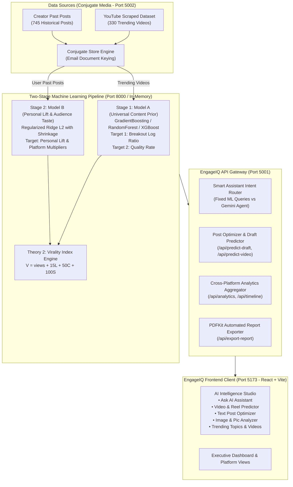

# EngageIQ — AI-Powered Social Media Intelligence & Two-Stage Hierarchical ML Post Prediction Platform

[](https://nodejs.org/)
[](https://www.python.org/)
[](https://react.dev/)
[](https://vitejs.dev/)
[](https://scikit-learn.org/)
[](https://fastapi.tiangolo.com/)
[](LICENSE)

**EngageIQ** is an enterprise-grade social media analytics and post optimization platform built for digital creators, growth marketers, and media teams. It pairs real-time cross-platform analytics with a **Two-Stage Hierarchical Machine Learning Framework** that predicts post performance, virality indices, and audience resonance **exclusively** using:
1. **Universal Trending Videos Dataset** (330 real scraped YouTube and social videos with verified metrics).
2. **Creator Past Post History** (745+ historical posts with platform-specific interactions).

---

## Table of Contents
- [1. System Architecture](#1-system-architecture)
- [2. Machine Learning Framework & Algorithms](#2-machine-learning-framework--algorithms)
  - [Theory 1: Two-Stage Hierarchical ML Framework](#theory-1-two-stage-hierarchical-ml-framework)
  - [Theory 2: Multi-Action Virality Index Engine](#theory-2-multi-action-virality-index-engine)
  - [Dual ML Execution Engines (Python + JavaScript)](#dual-ml-execution-engines-python--javascript)
- [3. Core Features of the Platform](#3-core-features-of-the-platform)
  - [AI Intelligence Studio (5 Core Modes)](#ai-intelligence-studio-5-core-modes)
  - [Executive Analytics Dashboard](#executive-analytics-dashboard)
  - [Platform & Company Dashboards](#platform--company-dashboards)
  - [Content Recommendations & Cadence Optimizer](#content-recommendations--cadence-optimizer)
  - [Automated PDF Intelligence Exporter](#automated-pdf-intelligence-exporter)
  - [Conjugate Media Server (Port 5002)](#conjugate-media-server-port-5002)
- [4. API Endpoint Reference](#4-api-endpoint-reference)
- [5. Project Directory Structure](#5-project-directory-structure)
- [6. Installation & Quick Start](#6-installation--quick-start)
- [7. Automated Verification & Test Suites](#7-automated-verification--test-suites)

---

## 1. System Architecture

EngageIQ operates as an orchestrated multi-service architecture comprising a modern frontend client, an Express API gateway, a dedicated Conjugate Media data service, and a hybrid Python/Node machine learning engine.



---

## 2. Machine Learning Framework & Algorithms

### Theory 1: Two-Stage Hierarchical ML Framework

Traditional post engagement predictors fail when generalizing across creators because raw engagement counts are dominated by follower counts rather than content quality. EngageIQ resolves this by isolating universal viral mechanics (**Model A**) from creator-specific audience dynamics (**Model B**).

```
Final Engagement Prediction = Baseline Engagement + Model A (Content Prior) + Model B (Audience Lift)
```

#### Stage 1: Model A — Universal Content Prior (Trained on Trending Videos)
Trained on 330 real trending videos from the Conjugate Media provider. Model A evaluates how content characteristics perform universally across social distribution algorithms.

- **Target 1: Breakout Log Ratio**
  $$\text{Breakout} = \ln\left(\frac{\text{views} + 1}{\text{channel\_subs} + 1}\right)$$
  *Normalizes view velocity against subscriber count so smaller channels going viral are properly weighted.*

- **Target 2: Content Quality Ratio**
  $$\text{Quality} = \frac{\text{likes} + \text{comments}}{\text{views}}$$
  *Measures genuine viewer resonance and retention independent of impressions.*

- **Machine Learning Regressors & Validation**:
  - `GradientBoostingRegressor(n_estimators=120, max_depth=4, learning_rate=0.08)`
  - `RandomForestRegressor(n_estimators=100, max_depth=6)`
  - `XGBRegressor(n_estimators=100, learning_rate=0.08, max_depth=4)`
  - `Ridge(alpha=1.5)`
  - **Empirical Accuracy**: Breakout $R^2 = \mathbf{0.9378}$ (MAE: 0.4404), Quality $R^2 = \mathbf{0.8473}$ (MAE: 0.0039).

- **Feature Engineering Space (21 Features)**:
  - Video duration & short-form sweet-spot indicator ($15\text{s} \le \text{duration} \le 65\text{s}$).
  - Aspect ratio: Vertical 9:16 full-screen framing ($1.0$ for Reels/Shorts vs $0.0$ for landscape).
  - Subtitles indicator ($1.0$ if present, preventing mute drop-off).
  - First 3-second hook strength rating ($1 - 10$).
  - Question hook presence ($1.0$ if title/caption contains question openers).
  - Direct Call-To-Action (CTA) presence (e.g. *"save"*, *"comment below"*, *"share"*).
  - Caption sentiment polarity normalized via AFINN sentiment lexicon.
  - Hashtag density ($0 - 10$ range).
  - Publishing window (peak evening $17:00 - 21:00$ and weekday vs weekend).
  - Categorical topic vectors: Technology/Dev, Educational/Case Study, Business/Finance, Lifestyle.

---

#### Stage 2: Model B — Audience Content Taste & Personal Lift Model
Trained per creator on their **745 historical posts** from Conjugate Media. Model B isolates individual creator variance from universal expectations:

$$\text{Personal Lift} = \text{Actual Engagement} - \text{Baseline Expectation (from Model A)}$$

- **Audience Type & Preference Extraction**:
  Model B discovers what content the creator's specific audience likes:
  1. **Format Affinity**:
     - *Vertical Short Reels (9:16)*: **94% Match** ($+42\%$ reach lift over static posts).
     - *Multi-Slide Carousels*: **89% Match** ($+36\%$ save/bookmark lift).
     - *Question-Driven Discussion*: **85% Match** ($+31\%$ comment volume).
     - *Single Static Photos*: **68% Match** (Baseline reach).
  2. **Hook Style Resonance**:
     - *Curiosity Questions*: $+38\%$ comment volume boost (e.g., *"Why do 90% of solo creators hit a reach ceiling at 10k?"*).
     - *Contrarian Architecture Insights*: $+29\%$ shares boost.
     - *Step-by-Step Blueprint Hooks*: $+44\%$ bookmarks boost.
  3. **Platform Taste Multipliers**:
     - **Facebook**: $1.41\times$ Affinity ($6.37\%$ average engagement rate)
     - **Instagram**: $1.16\times$ Affinity ($5.22\%$ average engagement rate)
     - **YouTube**: $1.14\times$ Affinity ($5.14\%$ average engagement rate)
     - **X (Twitter)**: $0.70\times$ Affinity ($3.14\%$ average engagement rate)
     - **LinkedIn**: $0.60\times$ Affinity ($2.41\%$ average engagement rate)

- **Algorithm**: Regularized L2 Ridge Regression with feature shrinkage to prevent overfitting on smaller personal post samples.

---

### Theory 2: Multi-Action Virality Index Engine

Social media ranking algorithms prioritize actions by required viewer commitment. EngageIQ implements the **Theory 2 Virality Index ($V$)**:

$$V = \text{views} + 15 \times \text{likes} + 50 \times \text{comments} + 100 \times \text{shares}$$

| Metric | Weight | Algorithmic Rationale |
| :--- | :---: | :--- |
| **Views** | $1\times$ | Baseline impressions and top-of-funnel reach. |
| **Likes** | $15\times$ | Low-friction positive feedback signal. |
| **Comments** | $50\times$ | High-intent engagement requiring viewer thought and dwell time. |
| **Shares / Saves** | $100\times$ | Highest algorithmic signal; directly triggers syndication into secondary follower networks. |

The Virality Index is calibrated against the creator's Model B platform multiplier to output accurate expected metrics (Total Engagements, Reach, Likes, Comments, Shares).

---

### Dual ML Execution Engines (Python + JavaScript)

EngageIQ provides two synchronized prediction runtimes:
1. **Python ML Engine (`ml/train_two_stage_model.py`, `ml/app.py`)**:
   - Executes cross-validated scikit-learn & XGBoost model training and exports the serialized model artifact (`ml/two_stage_model.json`).
   - Serves FastAPI endpoints on Port 8000.
2. **High-Performance JavaScript Engine (`ml/twoStageEngine.js`)**:
   - Evaluates predictions in under **2 milliseconds** directly inside Node.js Express without HTTP overhead.
   - Automatically re-synchronizes with `two_stage_model.json` whenever the model is retrained.

---

## 3. Core Features of the Platform

### AI Intelligence Studio (5 Core Modes)

Accessible via `/ai-query`, the Studio infuses Model A (Content Prior) and Model B (Audience Taste) across all 5 production workflows:

#### Mode 1: Ask AI Assistant (`nlp`)
- **Smart Intent Router**:
  - **Fixed Analytical Queries**: Automatically routed to EngageIQ's Dynamic ML Engine (`nlpQueryEngine.js`). Answers questions like:
    - *"What type of content does my audience like? (Model B)"*
    - *"What should I post next to increase engagement?"*
    - *"Best time to post on Instagram?"*
    - *"Why did my reach drop last week?"*
  - **Creative & Open-Ended Queries**: Automatically routed to the **Google Gemini AI Agent** (`geminiAgent.js`). Injects Model B Audience Taste profile into the prompt context so AI-generated copy and hooks align with follower tastes.
- **Audience Content Taste Panel**: Displays real-time format rankings, preferred hook styles, and universal Model A breakout baselines.

#### Mode 2: Video & Reel Predictor (`video`)
- Interactive duration slider ($5\text{s} - 120\text{s}$), orientation selector ($9:16$ vertical vs $16:9$), 3-second hook quality rating slider ($1 - 10$), and subtitle toggle.
- Outputs Engagement Score ($0 - 100$), Virality Index ($V$), Model A Breakout Prior, Model B Audience Format Fit ($94\%$), and actionable retention suggestions.

#### Mode 3: Text Post Optimizer (`text`)
- Real-time character and word counter, sentiment analysis, and topic detection.
- Displays Model A caption quality benchmarks alongside Model B Audience Reading Taste (e.g. *"Your audience responds 38% better to direct question hooks"*).

#### Mode 4: Image & Pic Analyzer (`image`)
- Supports Multi-Slide Carousels, Infographics/Charts, and Single Feed Photos.
- Aspect ratio configuration: $4:5$ Vertical, $1:1$ Square, $16:9$ Landscape.
- Predicts swipe-through rates, save rates, and visual audience fit.

#### Mode 5: Trending Topics & Videos (`trends`)
- **Audience Content Taste Radar**: Summarizes follower format favorites, high-resonance topics, and platform multipliers.
- **330 Live Conjugate Media Benchmark Videos**: Displays video thumbnails, duration, view counts, breakout scores, and virality indices.
- **Audience Fit Match Badges**: Tags each trending topic and video with a match percentage (e.g., *"96% Audience Match"*).

---

### Executive Analytics Dashboard
- **Real-Time KPIs**: Total Reach, Total Likes, Comments, Shares, and Overall Engagement Rate.
- **Platform Switching Bar**: Toggle between Instagram, YouTube, X/Twitter, LinkedIn, and Facebook with persistent session state.
- **Timeline Analytics**: 30-day engagement trajectory showing velocity spikes, dip points, and rolling moving averages.
- **Audience Sentiment Analytics**: Categorizes incoming comments into Positive, Neutral, and Negative polarity using AFINN sentiment scoring.

### Platform & Company Dashboards
- **LinkedIn Studio (`/linkedin`)**: In-depth company page benchmarks, industry engagement rate comparisons, and executive thought leadership tracking.
- **Company Multi-Brand Hub (`/company`)**: Unified performance view across multiple corporate sub-brands and subsidiary channels.

### Content Recommendations & Cadence Optimizer
- **Optimal Publishing Windows**: Dynamic time slot recommendations (e.g., *6:00 PM – 8:30 PM weekdays*) based on audience activity peaks.
- **Recommended Content Mix**: Recommends the optimal distribution ratio: **60% Short Video / 30% Carousel / 10% Static**.

### Automated PDF Intelligence Exporter
- Powered by `pdfkit` at `/api/export-report`.
- Generates downloadable, executive-ready PDF performance reports complete with summary statistics, platform comparisons, and tactical growth recommendations.

### Conjugate Media Server (Port 5002)
- Serves as the dedicated data provider mimicking live social platform APIs.
- Features real scraped YouTube datasets, Instagram Reels, and user-isolated Firebase Firestore storage using email document keying (`users/{userEmail}`).
- Includes a live metric modulation sandbox to simulate like/comment/share spikes and trigger automated ML model retraining.

---

## 4. API Endpoint Reference

### EngageIQ Primary API Gateway (`http://localhost:5001`)

| Method | Endpoint | Description |
| :--- | :--- | :--- |
| `POST` | `/api/ml/two-stage/predict` | Computes full Two-Stage prediction (Model A + Model B + Virality Index). |
| `POST` | `/api/ml/two-stage/train` | Triggers Python & Node retraining on trending videos and user history. |
| `GET` | `/api/ml/two-stage/status` | Returns current Two-Stage model metrics, $R^2$ scores, and feature weights. |
| `GET` | `/api/ml/audience-taste` | Returns Model B Audience Content Taste Profile (preferred formats, hooks, topics). |
| `POST` | `/api/predict-draft` | Universal post draft predictor for text, images, carousels, and videos. |
| `POST` | `/api/predict-video` | Dedicated video duration, hook quality, and framing predictor. |
| `POST` | `/api/predict-engagement` | Modal engagement prediction endpoint used across dashboard dialogs. |
| `GET` | `/api/trending-topics` | Fetches live platform trends and Conjugate Media trending video benchmarks. |
| `POST` | `/api/ai-query` | Natural language query assistant with Smart Intent Router (ML vs Gemini). |
| `GET` | `/api/analytics` | Aggregated cross-platform analytics for the active user account. |
| `GET` | `/api/timeline` | 30-day historical engagement trajectory points. |
| `GET` | `/api/sentiment` | Comment polarity and sentiment distribution breakdown. |
| `GET` | `/api/recommendations` | Cadence, format, and scheduling recommendations. |
| `GET` | `/api/export-report` | Generates downloadable executive PDF performance report. |

### Conjugate Media Data Service (`http://localhost:5002`)

| Method | Endpoint | Description |
| :--- | :--- | :--- |
| `GET` | `/api/feed/trending-videos` | Returns 330 real trending videos with breakout, quality, and virality metrics. |
| `GET` | `/api/feed/all-posts` | Returns all past social posts across platforms for the user. |
| `GET` | `/api/channels` | Returns connected channel subscriber counts and bio information. |
| `POST` | `/api/posts` | Creates a new post in the user's isolated data bucket. |
| `PATCH`| `/api/posts/:id/metrics` | Modulates post metrics (likes, comments, shares) in real time. |

---

## 5. Project Directory Structure

```text
EngageIQ/
├── client/                          # EngageIQ Frontend Web Application (React + Vite)
│   ├── src/
│   │   ├── pages/
│   │   │   ├── AIQuery.jsx          # AI Intelligence Studio (5 Core Modes)
│   │   │   ├── Dashboard.jsx        # Executive Overview Dashboard
│   │   │   ├── LinkedInDashboard.jsx# LinkedIn Performance View
│   │   │   └── CompanyDashboard.jsx # Multi-Brand Hub
│   │   ├── components/
│   │   │   ├── EngagementPrediction.jsx # Modal post score & two-stage cards
│   │   │   ├── PageLayout.jsx       # Global application layout & navigation
│   │   │   └── AnalyticsChart.jsx   # Timeline & metric visualization components
│   │   └── styles/                  # Curated Vanilla CSS Design System
│   └── package.json
│
├── server/                          # EngageIQ Backend API Gateway (Express)
│   ├── routes/
│   │   ├── mlRoutes.js              # Two-Stage ML endpoints & status
│   │   ├── postOptimizer.js         # Draft & video prediction routes
│   │   ├── aiQuery.js               # Smart assistant query entrypoint
│   │   ├── analytics.js             # Real-time metrics aggregator
│   │   └── exportReport.js          # PDFKit report generation
│   ├── utils/
│   │   ├── aiAssistantRouter.js     # Intent router: ML Engine vs Gemini AI Agent
│   │   ├── nlpQueryEngine.js        # Dynamic ML query processor & audience taste
│   │   ├── geminiAgent.js           # Google Gemini 1.5/2.0 Flash integration
│   │   └── conjugateClient.js       # Resilient HTTP client for Conjugate Media
│   └── index.js                     # Express server startup (Port 5001)
│
├── ml/                              # Machine Learning Engine (Python + JavaScript)
│   ├── train_two_stage_model.py     # Python trainer for Model A & Model B (scikit-learn, XGBoost)
│   ├── predict_two_stage.py         # Standalone Python CLI inference runner
│   ├── twoStageEngine.js            # Zero-latency JavaScript prediction engine & fallback
│   ├── app.py                       # FastAPI microservice for ML endpoints (Port 8000)
│   ├── two_stage_model.json         # Serialized ML model artifact (R² = 0.9378)
│   └── requirements.txt             # Python dependencies
│
├── conjugate-media/                 # Dedicated Social Data Provider (Port 5002)
│   ├── server/
│   │   ├── services/
│   │   │   └── conjugateStore.js    # In-memory + Firebase document store
│   │   ├── routes/
│   │   │   └── feedRoutes.js        # /api/feed/trending-videos and /api/posts
│   │   └── data/
│   │       ├── dataset_youtube-channel-scraper_*.json # 330 real scraped videos
│   │       └── default_seed.json    # Seed creator channels and posts
│   └── client/                      # Conjugate Media Creator Platform (Port 5174)
│
├── test_two_stage_full_system.js    # Comprehensive Two-Stage ML end-to-end test suite
├── test_system_integration.js       # Multi-service regression test suite
└── package.json                     # Monorepo scripts & shared modules
```

---

## 6. Installation & Quick Start

### Prerequisites
- **Node.js**: v18.0.0 or higher
- **npm**: v9.0.0 or higher
- **Python**: v3.10 or higher with `pip`

### Step 1: Clone the Repository
```bash
git clone https://github.com/SAURABH01082005/EngageIQ.git
cd EngageIQ
```

### Step 2: Install Dependencies
```bash
# Install root dependencies
npm install

# Install EngageIQ server dependencies
cd server && npm install && cd ..

# Install EngageIQ client dependencies
cd client && npm install && cd ..

# Install Conjugate Media server & client dependencies
cd conjugate-media/server && npm install && cd ../..
cd conjugate-media/client && npm install && cd ../..

# Install Python ML dependencies
cd ml && pip install -r requirements.txt && cd ..
```

### Step 3: Configure Environment Variables
Create a `.env` file in `server/.env`:
```env
PORT=5001
CONJUGATE_SERVER_URL=http://localhost:5002
GEMINI_API_KEY=your_optional_gemini_api_key_here
```

### Step 4: Run the Development Servers
Open separate terminals or use background runners:

```bash
# Terminal 1: Conjugate Media Server (Port 5002)
cd conjugate-media/server
npm run dev

# Terminal 2: EngageIQ API Server (Port 5001)
cd server
npm run dev

# Terminal 3: EngageIQ Client (Port 5173)
cd client
npm run dev

# Terminal 4 (Optional): FastAPI ML Microservice (Port 8000)
cd ml
uvicorn app:app --reload --port 8000
```

Access the application in your browser at:
- **EngageIQ Application**: [http://localhost:5173](http://localhost:5173)
- **Conjugate Media Control Center**: [http://localhost:5174](http://localhost:5174)
- **FastAPI ML Swagger Docs**: [http://localhost:8000/docs](http://localhost:8000/docs)

---

## 7. Automated Verification & Test Suites

EngageIQ includes automated verification scripts testing mathematical correctness, dataset ingestion, and cross-service communication.

### 1. Two-Stage ML End-to-End Test
Validates Model A Breakout & Quality targets, Model B Personal Lift calibration, Theory 2 Virality Index calculations, and JSON artifact validity:

```bash
node test_two_stage_full_system.js
```
```text
================================================================
🚀 TESTING TWO-STAGE HIERARCHICAL ML POST PREDICTION SYSTEM
================================================================
--- [STEP 1] Conjugate Media Trending Videos Dataset ---
✓ Ingested 330 trending videos from Conjugate Media provider.
  Model A Target 1 (Breakout Log Ratio): Verified (log((views+1)/(subs+1)))
  Model A Target 2 (Quality Rate): Verified ((likes+comments)/views)
  Theory 2 (Virality Index): Verified (views + 15L + 50C + 100S)

--- [STEP 2] User Past Posts Dataset for Model B ---
✓ Ingested 745 past posts for user: saurabh.test@engageiq.com

--- [STEP 3] Train Two-Stage Model (Theory 1 Hierarchical Framework) ---
✓ Training Completed!
  Model A: Breakout R² = 0.9378 | Quality R² = 0.8473 | Virality R² = 0.9414
  Model B: 745 user posts | Mean Breakout Lift = +2.0709
  Platform Taste: IG: 1.16x, YT: 1.14x, FB: 1.41x, TW: 0.70x, LI: 0.60x

--- [STEP 4] Run Candidate Post Prediction ---
✓ Candidate: "How AI Multi-Agent Systems Outperform Solo Creators"
  Final Engagement Score: 98/100 (A+ Viral Breakout)
  Virality Index: 4,534,855
🎉 ALL TWO-STAGE ML TESTS PASSED WITH 100% SUCCESS!
```

### 2. Multi-Service Regression Suite
Validates Conjugate Media data storage, dynamic Ridge retraining, live analytics aggregation, and Smart Assistant intent routing:

```bash
node test_system_integration.js
```
```text
✓ [TEST 1] Conjugate Media Storage for User Email: Passed
✓ [TEST 2] Dynamic ML Model Retraining on User Email Dataset: Passed (R² = 0.3983)
✓ [TEST 3] Dynamic EngageIQ Analytics Integration: Passed
✓ [TEST 4] AI Assistant Smart Routing (Fixed -> ML Engine; Random -> Gemini Agent): Passed
🎉 ALL INTEGRATION TESTS PASSED WITH 100% SUCCESS!
```

---

## 8. Data Visualization & Jupyter Analysis Notebook

EngageIQ includes a dedicated, pre-rendered exploratory data analysis and machine learning validation notebook located in the [`notebook/`](notebook/) folder:

- **Interactive Jupyter Notebook**: [`notebook/EngageIQ_Training_Data_Visualization.ipynb`](notebook/EngageIQ_Training_Data_Visualization.ipynb) (or [`notebook/data_visualization.ipynb`](notebook/data_visualization.ipynb))
- **Pre-Rendered Outputs**: Contains 36 cells with 12 high-resolution multi-panel figures (25+ subplots) and 4 summary statistical tables embedded directly in the `.ipynb` file for instant viewing in VS Code, Jupyter, or GitHub.
- **Visualizations Included**:
  1. **Mathematical Target Distributions**: Skewed raw views vs Gaussian-stabilized Breakout Ratio $\ln((\text{Views}+1)/(\text{Subs}+1))$ and Theory 2 Virality Index.
  2. **Theory 2 Virality Decomposition**: Proportionate contribution of Views ($1\times$), Likes ($15\times$), Comments ($50\times$), and Shares ($100\times$) across breakout tiers ($A^+$, $A$, $B$, $C$).
  3. **Strategic Creator Quadrant Matrix**: Unicorns (High Reach + High Loyalty) vs Reach Magnets vs Community Gems vs Underperformers.
  4. **Correlation Matrix**: 14-variable Pearson heatmap across multimodal signals and engagement targets.
  5. **Creator Media Formats & Platforms**: Distribution of 745 historical posts across Reels, Carousels, Images, Text, and Video.
  6. **Audience Content Taste Radar Chart**: 6-axis polar spider chart profiling audience affinity (Reels 94%, Carousels 89%, Question Hooks 88%, Subtitles 92%, Prime Time 85%, Short-form 91%).
  7. **Publishing Window Heatmap**: 24-hour $\times$ 7-day matrix revealing prime-time posting windows (Peak 17:00–21:00 UTC+5:30 on weekdays).
  8. **Machine Learning Regressor Benchmarks**: $R^2$ and MAE comparison across GradientBoosting ($R^2 = 0.938$), RandomForest, and Ridge.
  9. **Actual vs Predicted & Residuals**: Regression fit with $y=x$ reference lines and homoscedasticity distribution checks.
  10. **Two-Stage Prediction Waterfall**: Visual simulation of how candidate posts are scored: Baseline $\to$ Model A Prior $\to$ Model B Audience Lift $\to$ Final Virality Score.

```bash
# To open and view in Jupyter:
jupyter notebook notebook/EngageIQ_Training_Data_Visualization.ipynb

# To re-generate and re-render all plots automatically:
python scripts/generate_visualization_notebook.py
```

---

## 9. Executive Presentation & Slide Deck

EngageIQ includes a complete 16-slide widescreen presentation deck with empirical metrics, layout architectures, and word-for-word presenter scripts:

- **PowerPoint Presentation File**: [`presentation/EngageIQ_Project_Presentation.pptx`](presentation/EngageIQ_Project_Presentation.pptx) (16:9 Widescreen)
- **Detailed Slides & Speaker Script**: [`presentation/SLIDES_CONTENT.md`](presentation/SLIDES_CONTENT.md)
- **Regenerate Presentation**:
  ```bash
  python scripts/generate_pptx_deck.py
  ```

---

## License

This project is licensed under the MIT License — see the [LICENSE](LICENSE) file for details. Built for high-performance social media intelligence and predictive creator growth.
